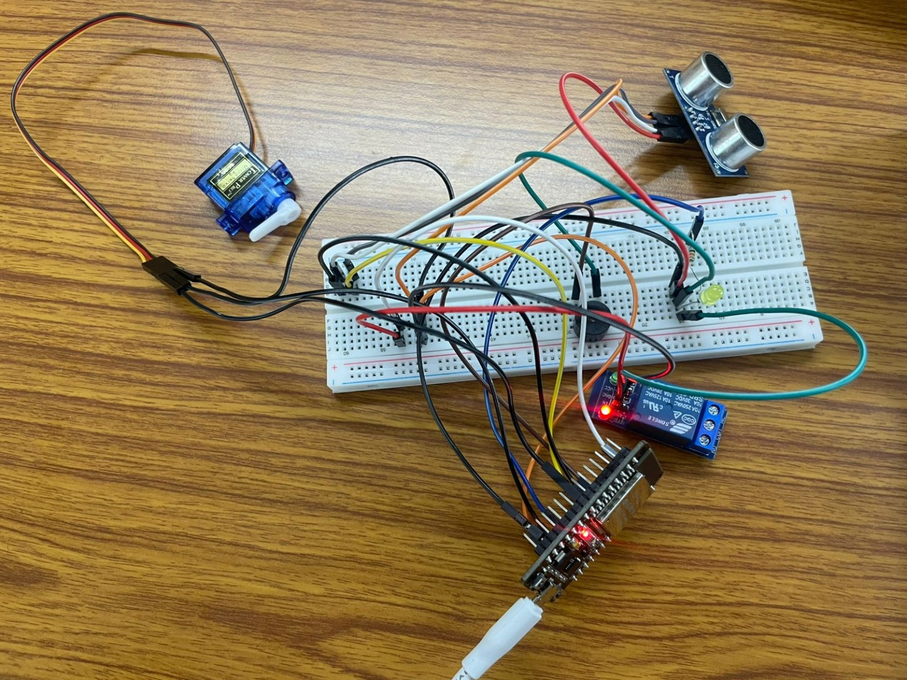

# HydroGate — Automated Water Level Controller for a Miniature Dam Model

An ESP32-based water level controller built as a miniature dam model. An ultrasonic
sensor measures the water level; a servo motor acts as the dam gate valve, a relay
switches the pump motor, and a buzzer + LED alert when the dam is full.

This was my first hardware project, built in my first year as the final project of
the LEAP bootcamp ("Product design with Reverse Engineering & Automation basics
with ESP32", 19–23 January 2026, VESIT Chembur, Maker Bhavan / IIT Madras
Incubation Cell).

## How it works

The HC-SR04 ultrasonic sensor is mounted above the tank and measures the distance
to the water surface. Small distance = high water level. The controller has three
states:

| State | Distance | Motor (relay) | Gate (servo) | Buzzer | LED |
|---|---|---|---|---|---|
| Dam full | ≤ 5 cm | OFF | Closed (90°) | ON | ON |
| Normal level | 5–10 cm | Unchanged | Unchanged | OFF | OFF |
| Tank low | ≥ 10 cm | ON | Open (0°) | OFF | OFF |

The 5–10 cm dead band is deliberate: it stops the motor and gate from flicking
on and off when the water sits near a threshold.

## Hardware

| Component | Model / notes |
|---|---|
| Microcontroller | ESP32 |
| Distance sensor | HC-SR04 ultrasonic |
| Gate valve | Servo motor |
| Pump control | Relay module |
| Alerts | Buzzer, LED |
| Build | Breadboard + jumper wires |

## Demo

Watch the prototype in action: [demo.mp4](docs/demo.mp4)

## Pin map

| Signal | ESP32 pin |
|---|---|
| HC-SR04 TRIG | 5 |
| HC-SR04 ECHO | 18 |
| Relay (motor) | 23 |
| Buzzer | 19 |
| LED | 2 |
| Servo (gate valve) | 25 |

## How to run

1. Open `firmware/hydrogate/hydrogate.ino` in the Arduino IDE.
2. Install the `ESP32Servo` library (Library Manager).
3. Select your ESP32 board and port, then upload.
4. Open the Serial Monitor at 9600 baud to see the measured distance and state.

## Limitations

- Water level is inferred from distance to the surface; the sensor is not
  calibrated against a reference, so readings are approximate.
- The gate and pump are a scale model — this is a learning prototype, not a
  real dam control system.
- `pulseIn()` blocks while waiting for an echo, so the loop timing is not exact.

## Credits

- Built by a 3-person team as the final project of the LEAP bootcamp, Jan 2026.
- The idea and first draft of the code were ChatGPT-assisted; the wiring,
  debugging and working prototype were our own work.

## License

MIT — see [LICENSE](LICENSE).
